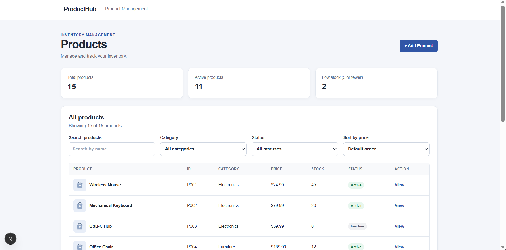
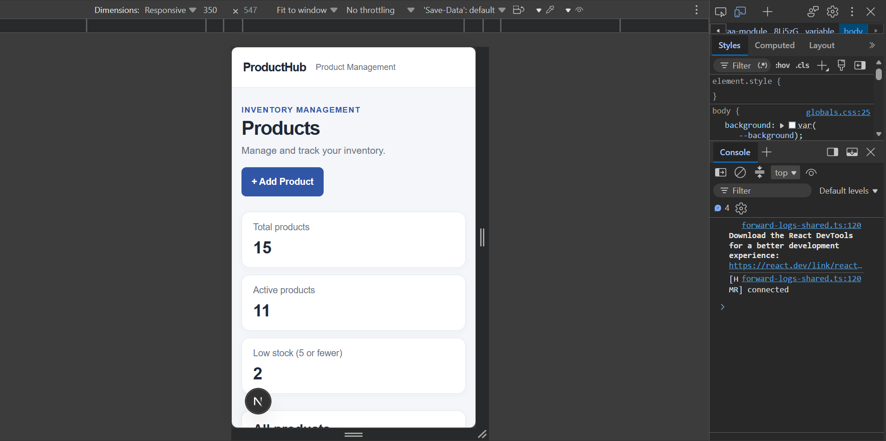

# Product Management Dashboard

## Overview

A responsive Product Management Dashboard built with Next.js, React, and TypeScript. The application allows users to browse products, search and filter the product list, sort products by price, add and edit products, and view individual product details.

## Features

- **Product Listing:** Displays 15 or more products with their ID, name, category, price, stock, status, and thumbnail.
- **Search:** Search for products by name with case-insensitive matching.
- **Filtering:** Filter products by category and status.
- **Sorting:** Sort products by price in ascending or descending order.
- **Add and Edit Products:** Create new products and update existing product information.
- **Form Validation:** Validates required fields, positive prices, and non-negative whole-number stock quantities.
- **Product Details:** View individual products on a dedicated details page.
- **Error Handling:** Handles invalid product IDs, failed requests, and empty search results.
- **Responsive Design:** Designed to work across desktop, tablet, and mobile screens.

## Technologies Used

- Next.js
- React
- TypeScript
- Regular CSS

## Prerequisites

- Node.js
- npm

## Installation

1. Clone the repository:

   ```bash
   git clone [MY_GITHUB_REPOSITORY_URL]
   ```

2. Navigate to the project directory:

   ```bash
   cd [MY_PROJECT_FOLDER]
   ```

3. Install dependencies:

   ```bash
   npm install
   ```

4. Start the development server:

   ```bash
   npm run dev
   ```

5. Open http://localhost:3000 in your browser.

## Data Source

The application uses API mock data.

Product changes do not require permanent database storage or persistence after refreshing the page.

## Screenshots

### Desktop View



### Mobile View



## Running the Production Build

To check the production build, run:

```bash
npm run build
```

To start the production server after a successful build, run:

```bash
npm run start
```

## Notes

This project was developed as part of a Junior Developer take-home assessment.
